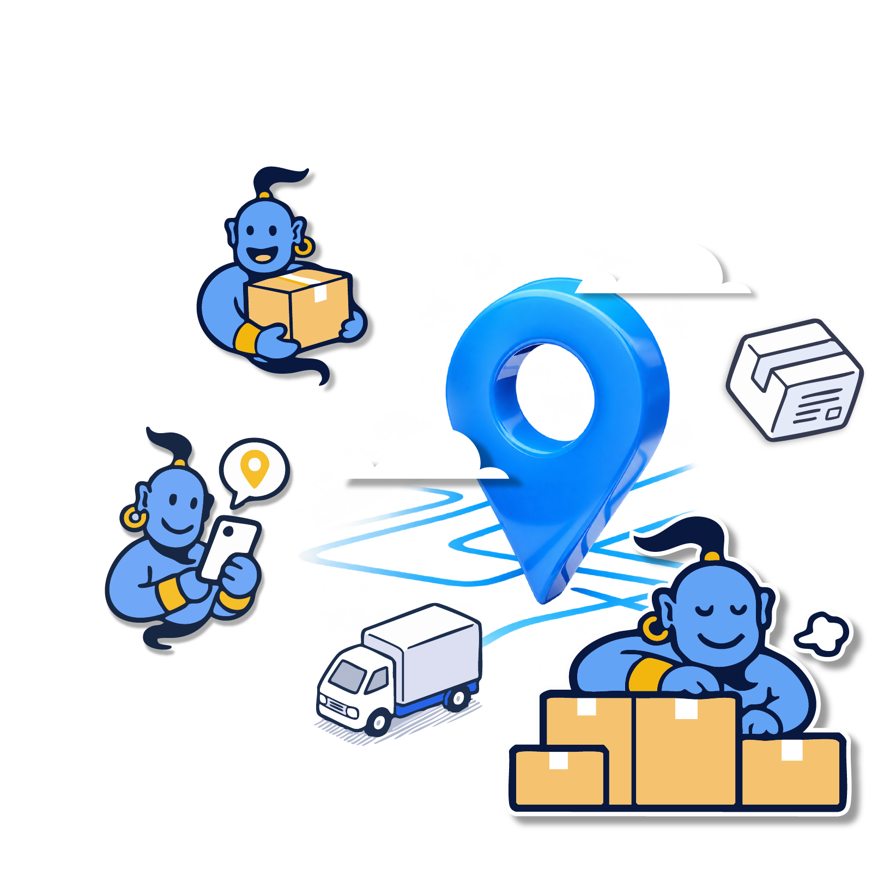
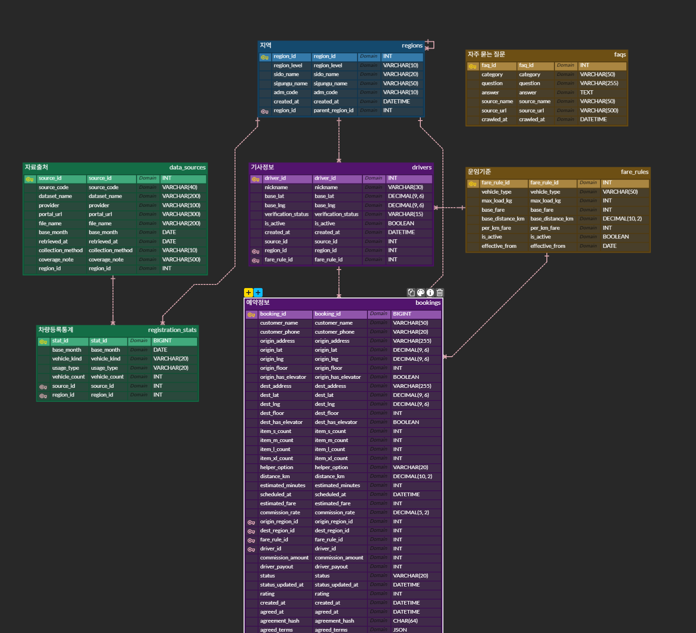

<p align="center">
  
</p>

<h3 align="center">짐 옮길 땐, 짐니! — 생활 물류·소형 화물 운송 중개 플랫폼</h3>

<p align="center">
  
</p>

생활 속에서 발생하는 **소형 이사·단건 운송 수요와 개인 운송사업자를 연결하는 양면 플랫폼**입니다.

소비자에게는 투명하고 편리한 운송 경험을, 기사에게는 효율적인 일감 확보와 업무 관리 환경을 제공합니다.

특히 여성·1인 가구가 안심하고 서비스를 이용할 수 있도록 **사전 확정 운임, 기사 정보 확인, 운송 상태 조회**를 핵심 기능으로 기획했습니다.

> 본 서비스는 학습용 시연 서비스입니다. 기사 정보는 시연용 가상 데이터이며, 실제 운송 요청·결제는 이루어지지 않습니다.

## 🎯 프로젝트 목표

- **합리적인 운송:** 운송 조건에 따른 차량 추천과 예상 운임 제공
- **투명한 거래:** 소비자·기사 간 최종 운임 사전 합의 및 추가요금 분쟁 예방
- **안심 서비스:** 기사 정보 및 운송 진행 상태 확인
- **효율적인 중개:** 기사 매칭과 수수료·정산 정보 제공
- **공공데이터 활용:** 지역별 영업용 화물차 등록 현황 시각화

## 🧭 서비스 흐름


| 단계 | 화면 | 내용 |
|---|---|---|
| 1 | 운송 신청 | 카카오 주소 검색으로 출발지·도착지 선택, 층수·엘리베이터·물품·인력·일시 입력 |
| 2 | 매칭 결과 | 추천 차량·예상 거리·운임 내역 확인, 추천 기사님(시연용 가상 기사) 확인 |
| 3 | 사전 동의 | 최종 운임·작업 조건 확인 후 동의 (조건이 바뀌면 동의 자동 해제·재계산) |
| 4 | 예약 확정 | 예약 저장 + 조건에 맞는 기사 자동 배정 → 예약번호 발급, **"기사님이 매칭되었습니다!"** 알림 |
| 5 | 예약 조회 | 예약번호 + 연락처로 예약 내용·운송 상태 확인, 운송 완료 후 별점 평가 |

## ✅ 구현 완료 기능

| 기능 | 주요 내용 |
|---|---|
| 📦 운송 신청 | 카카오 로컬 API 주소·장소 검색(카드형 결과, Enter 검색), 좌표 저장, 상세주소, 입력 검증(주소 미선택·같은 위치·0층 차단), 페이지 이동 후 입력값 유지 |
| 💵 운임 계산·차량 추천 | 카카오모빌리티 경로 거리, 거리 구간별 기본 운임 + 인력 비용 + 계단 작업 비용, 물품 크기·수량 기반 차량(다마스·라보·1톤) 추천 |
| 🤝 사전 확정 운임제 | 예약 전 최종 운임·작업 조건 확인 및 동의, 조건 변경 시 동의 자동 해제·재계산, 동의 시각·조건+운임 해시·스냅샷을 `bookings`에 저장 |
| 🚚 기사 매칭·예약 | 출발지 주변·차량 조건·같은 날 일정 기준 추천, 예약 확정 시 기사 자동 배정(일정이 겹치면 다음 후보), 중복 예약 방지, 예약번호 발급, 트랜잭션 롤백 |
| 🔔 웹 알림 | 예약·배정 저장 직후 매칭 완료 알림, 예약 조회에서 운송 상태(예약 완료·기사 출발·운송 중·운송 완료)별 알림 |
| 📋 예약 조회·평가 | 로그인 없이 예약번호 + 연락처로 본인 확인 후 조회, 운송 상태 단계 표시, 운송 완료 상태에서만 별점 평가 |
| ❓ FAQ | 팀이 작성한 FAQ 29건, 카테고리 필터 + 질문·답변 키워드 검색, 운임 요금표 안내 |
| 💳 요금표 | 차종별 기본요금·km당 요금 (`fare_rules`) |
| 🗺️ 화물차 현황 지도 | 국토교통부 OpenAPI 시도별 버블 지도(등록대수 구간별 색), 시도 클릭·선택 시 시군구 상세, 기준월·출처 안내 |
| 🎨 공통 화면 | 상단 메뉴(홈·운송 신청·화물차 현황·예약 조회·FAQ), 공통 푸터, 브랜드 컬러·Pretendard, 반응형 |

## 🚧 남은 기능

| 기능 | 현재 상태 | 계획 |
|---|---|---|
| 💰 수수료 및 정산 | 미구현 (`services/settlement.py` 빈 파일, `commission_*`·`driver_payout` 컬럼은 비어 있음) | 플랫폼 수수료율 확정 후 확정 운임·수수료·기사 예상 정산액 표시 |
| 🔄 운송 상태 변경 | 미구현 (예약은 `BOOKED`로 유지) | 시연용 관리자 화면에서 기사 출발 → 운송 중 → 운송 완료 변경 |
| ✏️ 예약 취소·변경 | 미구현 | 확정 예약의 취소, 조건 변경 시 재동의 |
| 🛡️ 기사 정보 보강 | 부분 구현 (평점·차량만 표시, 가상 기사는 모두 사업자 미확인) | 완료 건수·사업자 확인 정보 표시 |
| ❓ FAQ DB 적재 | 부분 구현 (`faqs` 테이블이 비어 있어 JSON 파일로 표시) | 정책 확정 후 `scripts/load_faqs.py --apply`로 적재 |
| 🗺️ 운송 신청 위치 지도 | 부분 구현 (카카오 JavaScript 키의 사이트 도메인 등록 필요) | 카카오 개발자 콘솔에 `http://localhost:8501` 등록 |

## 💻 기술 스택

| 구분 | 기술 |
|---|---|
| Language | Python |
| Data Processing | Pandas |
| Database | MySQL (PyMySQL) |
| Web Application | Streamlit |
| Visualization | pydeck (버블 지도) |
| Public Data | 국토교통부 통계누리 OpenAPI |
| External API | 카카오 로컬 API(주소·장소 검색), 카카오모빌리티 길찾기 API(거리), Kakao Maps JavaScript SDK(위치 지도) |
| Collaboration | Git, GitHub |

## 🗂️ 프로젝트 폴더 구조

```text
SKN38-1st-1Team/
│
├── app.py                      # Streamlit 진입점 (상단 메뉴·공통 디자인·푸터)
├── pages/                      # 화면
│   ├── 0_Home.py               # 홈 (서비스 소개·이용 방법·공공데이터 소개)
│   ├── 1_Delivery_Request.py   # 운송 신청 (카카오 주소 검색)
│   ├── 2_Driver_Matching.py    # 매칭 결과 (운임·차량 추천·추천 기사)
│   ├── 6_Booking.py            # 예약하기 (사전 동의·예약 확정·매칭 완료 알림)
│   ├── 3_Booking_Lookup.py     # 예약 조회·운송 상태·평가
│   ├── 4_Truck_Map.py          # 화물차 현황 (버블 지도)
│   ├── 5_FAQ.py                # FAQ
│   └── 7_Fare_Table.py         # 요금표
│
├── services/                   # 기능 로직
│   ├── fare.py · fare_table.py # 운임 계산·차량 추천·요금 기준
│   ├── matching.py             # 기사 추천
│   ├── booking.py              # 예약 저장
│   ├── agreement.py            # 사전 확정 운임 동의
│   ├── assignment.py           # 예약 확정 시 기사 자동 배정
│   ├── notifications.py        # 웹 알림
│   ├── booking_lookup.py       # 예약 조회·평가
│   ├── kakao_local.py          # 카카오 주소 검색·위치 지도
│   ├── truck_stats.py · truck_map.py  # 화물차 통계·버블 지도
│   ├── faq.py                  # FAQ 조회·검색
│   └── ui.py                   # 공통 디자인·헤더·푸터
│
├── scripts/                    # 데이터 수집·적재 (국토부 API, 시연 기사, FAQ)
├── data/                       # 원본·전처리 데이터, FAQ 원본
├── sql/                        # schema.sql, 조회 쿼리, 추가 컬럼 SQL
├── docs/                       # ERD, 서비스 흐름, 파이프라인 문서
├── assets/                     # 로고·지니 캐릭터 이미지
│
├── requirements.txt            # Python 라이브러리 목록
├── .env.example                # 환경변수 예시
├── .gitignore                  # Git 업로드 제외 설정
└── README.md
```

## 🗂️ ERD (데이터베이스 설계)

생활 물류·소형 화물 운송 중개 플랫폼의 데이터베이스는
총 **7개 테이블과 9개 외래 키(FK) 관계**로 구성되어 있습니다.

### 📌 ERD 전체 구조



### 🎨 테이블 색상 구분

| 색상 | 테이블 | 역할 |
|---|---|---|
| 🔵 파란색 | `regions` | 시도·시군구 지역 정보 |
| 🟢 초록색 | `data_sources`, `registration_stats` | 공공데이터 출처 및 화물차 등록 통계 |
| 🟣 보라색 | `drivers`, `bookings` | 기사 정보 및 운송 예약 |
| 🟡 노란색 | `fare_rules`, `faqs` | 운임 산정 기준 및 자주 묻는 질문 |

### 🔗 주요 테이블 관계

- `regions` → 지역 계층, 기사 활동 지역, 출발지·도착지 관리
- `data_sources` → `registration_stats` : 공공데이터 출처 관리
- `regions` → `registration_stats` : 지역별 화물차 등록 통계
- `fare_rules` → `drivers`, `bookings` : 차종별 운임 기준
- `drivers` → `bookings` : 기사별 운송 예약

### 🤝 사전 확정 운임 동의 기록 (`bookings`)

| 컬럼 | 타입 | 내용 |
|---|---|---|
| `agreed_at` | DATETIME | 소비자가 동의한 시각 |
| `agreement_hash` | CHAR(64) | 동의한 조건 + 운임 전체의 SHA-256 해시 |
| `agreed_terms` | JSON | 동의 당시 조건(주소·일시·층수·물품·인력)과 운임 내역 스냅샷 |

합의 운임은 `estimated_fare`에 저장됩니다. 이미 만들어 둔 DB에는 [`sql/bookings_agreement_columns.sql`](sql/bookings_agreement_columns.sql)을 한 번 실행합니다.

### 📊 공공데이터 연동

국토교통부 OpenAPI를 통해 지역별 영업용 화물차 등록대수를 수집하고,
Pandas로 전처리한 데이터를 MySQL에 저장합니다.

- **기준 데이터:** 2026년 9월 (전국 영업용 화물차 472,852대)
- **수집 대상:** 영업용 화물차 등록대수
- **수집 주기:** 국토교통부 월별 통계 갱신 기준
- **데이터베이스:** MySQL
- **중복 방지:** 동일 기준월 데이터 중복 저장 방지
- **오류 처리:** 트랜잭션 ROLLBACK으로 기존 데이터 보호

등록대수는 실제 운행 중이거나 지금 예약 가능한 차량 수가 아닙니다.

데이터 수집 및 갱신 과정은
[`docs/registration_pipeline.md`](docs/registration_pipeline.md)에서 확인할 수 있습니다.

DB 테이블 생성 SQL은 [`sql/schema.sql`](sql/schema.sql)에 있습니다.

## 🚀 실행 방법

### 1. GitHub 저장소 Clone

```bash
git clone https://github.com/SKNETWORKS-FAMILY-AICAMP/SKN38-1st-1Team.git
cd SKN38-1st-1Team
```

또는 VS Code에서 `Clone Git Repository`를 이용합니다.

### 2. 가상환경 생성 및 활성화

Windows PowerShell 기준:

```powershell
python -m venv .venv
.\.venv\Scripts\Activate.ps1
```

### 3. 라이브러리 설치

```powershell
python -m pip install -r requirements.txt
```

### 4. 환경변수 설정

`.env.example`을 복사해 `.env`를 만들고 필요한 API 키와 DB 연결 정보를 입력합니다.

```powershell
Copy-Item .env.example .env
```

| 변수 | 용도 |
|---|---|
| `MOLIT_API_KEY`, `MOLIT_API_URL` | 국토교통부 통계누리 OpenAPI |
| `KAKAO_REST_API_KEY` | 주소·장소 검색, 거리 계산 (서버에서만 사용) |
| `KAKAO_JAVASCRIPT_KEY` | 운송 신청 화면 위치 지도 (사이트 도메인 등록 필요) |
| `DB_HOST`, `DB_PORT`, `DB_USER`, `DB_PASSWORD`, `DB_NAME` | MySQL 연결 |

`.env`는 GitHub에 업로드하지 않습니다.

### 5. 데이터베이스 준비

```powershell
# 1) 테이블 생성: sql/schema.sql 실행 (MySQL Workbench 등)
# 2) 영업용 화물차 등록 통계 적재
python scripts/update_registration_db.py
# 3) 시연용 차종·가상 기사 데이터 준비
python -m scripts.seed_drivers
```

### 6. Streamlit 실행

```powershell
python -m streamlit run app.py
```

접속 주소: http://localhost:8501

## 👥 팀원 소개

<table>
  <tr>
    <td align="center" width="25%">
      <br>
      <b>[이름]</b><br>
      [역할]<br>
      <sub>[담당 기능]</sub>
    </td>
    <td align="center" width="25%">
      <br>
      <b>[이름]</b><br>
      [역할]<br>
      <sub>[담당 기능]</sub>
    </td>
    <td align="center" width="25%">
      <br>
      <b>[이름]</b><br>
      [역할]<br>
      <sub>[담당 기능]</sub>
    </td>
    <td align="center" width="25%">
      <br>
      <b>[이름]</b><br>
      [역할]<br>
      <sub>[담당 기능]</sub>
    </td>
  </tr>
</table>

## 🤝 GitHub 협업

팀원 4명이 `main` 브랜치를 기준으로 기능별 파일을 분담하여 개발합니다.

**작업 순서:** `Pull → 개발 → Commit → Pull → Push`

- 작업 전 최신 코드 Pull
- 담당 파일 위주로 수정
- 공통 파일 수정 시 팀원에게 공유
- API 키, DB 비밀번호, `.env`, `.venv` 업로드 금지
- 충돌 발생 시 강제 Push 금지

### 팀 GitHub

https://github.com/SKNETWORKS-FAMILY-AICAMP/SKN38-1st-1Team

---

**SK Networks Family AI Camp · SKN38 1st Project · 1Team**
