<p align="center">
  
</p>

<h3 align="center">짐 옮길 땐, 짐니! — 생활 물류·소형 화물 운송 중개 플랫폼</h3>

<p align="center">
  <b>택배로는 크고 이사로는 작은 짐,</b><br>
  차량 추천부터 운임 계산 · 기사 매칭 · 예약까지 한 번에 연결합니다.
</p>

<p align="center">
  <sub>학습용 시연 프로젝트입니다. 기사 정보는 가상 데이터이며, 실제 운송·결제는 이루어지지 않습니다.</sub>
</p>

<p align="center">
  <a href="https://jimni-delivery.streamlit.app/truck-map"><b>JIMNI 서비스 바로가기</b></a>
</p>

   ## 🎬 Demo

   <p align="center">
  <a href="https://github.com/SKNETWORKS-FAMILY-AICAMP/SKN38-1st-1Team/raw/main/assets/00_demo.mp4">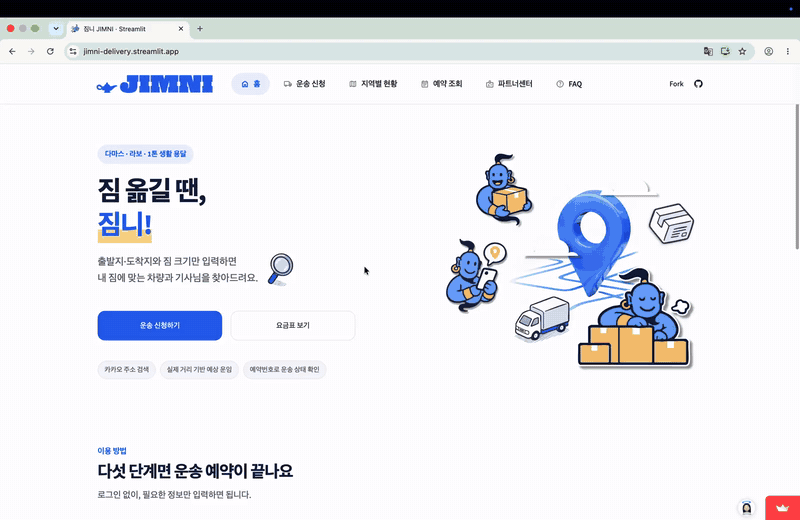</a>
</p>

   <p align="center">
  <sub>4배속 미리보기 · 운송 신청 → 매칭 결과 → 기사님 선택 → 예약 → 운송 상태 조회 → 별점 평가</sub><br>
  <sub>▶ 이미지를 누르면 원본 시연 영상(<code>00_demo.mp4</code>)이 다운로드됩니다</sub>

</p>

---

## Market & Problem

1인 가구의 주거 이동과 개인 간 중고거래가 늘면서, 짐의 양과 조건에 맞춘 **맞춤형 용달 매칭** 수요가 생기고 있습니다.

<p align="center">
  
</p>

<p align="center">
  
</p>

### Target Users

| 대상 | 이용 상황 | 짐니의 지원 |
|:---|:---|:---|
| **중고 가구 거래자** | 중고로 산 소파·책상을 판매자 집에서 우리 집으로 옮길 때 | 판매자 픽업지부터 구매자 배송지까지 운송 매칭 |
| **1인 가구·소형 이사** | 원룸·자취방 이사, 짐 몇 개만 옮기는 부분 이사 | 짐의 양에 맞는 차량 추천 및 운임 산정 |
| **소량 화물 운송 고객** | 가전 한 대, 박스 여러 개처럼 택배로 보내기 어려운 짐 | 물품 규격과 작업 조건에 맞는 용달 연결 |
| **개인 용달 기사님** | 다마스·라보·1톤으로 가까운 소형 일감을 찾을 때 | 출발지 기준 요청 추천, 정산 예상액 공개 |

---

## 💡 Why JIMNI?

- **간편한 예약:** 운송 조건 입력부터 기사 추천·예약 조회까지 연결된 흐름
- **운임 투명성:** 거리·물품·작업 옵션을 반영한 운임 확인과 예약 전 동의
- **안심 서비스:** 기사 정보 및 운송 진행 상태 확인
- **효율적인 중개:** 운송 조건에 맞는 기사 추천과 자동 배정
- **데이터 활용:** 공공데이터 기반 지역별 화물차 등록 현황 시각화

---

## How It Works

<p align="center">
  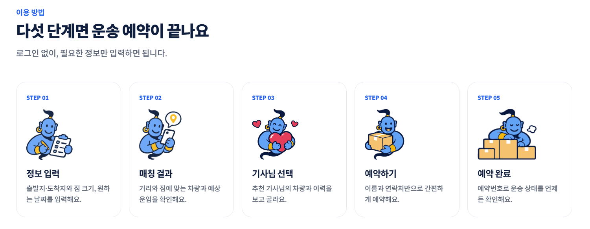
</p>

| 단계 | 주요 기능 |
|:---|:---|
| **01 · 정보 입력** | 카카오 주소·장소 검색, 출발지·도착지 선택 및 물품·작업 조건 입력 |
| **02 · 매칭 결과** | 도로 이동 거리, 예상 운임 및 적합한 차량 확인 |
| **03 · 기사님 선택** | 조건에 맞는 시연용 기사 추천·선택 |
| **04 · 예약하기** | 최종 운임·작업 조건 확인, 동의 및 예약 확정 |
| **05 · 예약 완료** | 기사 자동 배정 알림, 예약번호 발급 및 예약 조회 |

<details>
<summary><b>실제 서비스 화면 보기</b></summary>

| 화면 | 설명 |
|:---:|:---|
|  | **01 · 정보 입력**<br>주소 검색, 짐 크기·수량, 층수·인력 조건 입력 |
|  | **02 · 매칭 결과**<br>실제 주행거리, 적합 차량, 항목별 예상 운임 |
|  | **03 · 기사님 선택**<br>기사님 5명을 가까운 순·별점 순으로 비교 |
|  | **04 · 예약하기**<br>최종 운임·작업 조건 동의 후 예약 확정 |
|  | **05 · 예약 조회**<br>예약번호로 운송 단계 확인 |
|  | **06 · 별점 평가**<br>운송 완료 후 0.5점 단위 별점 입력 |

</details>

<details>
<summary><b>서비스 흐름도 자세히 보기</b></summary>

<p align="center">
  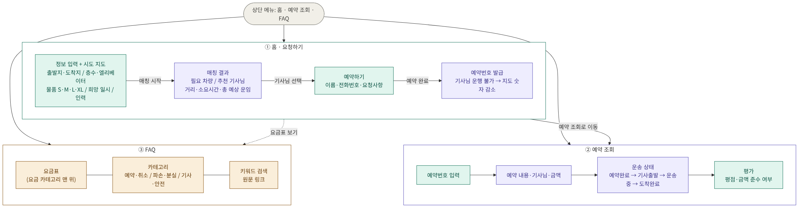
</p>

</details>

---

## 🖥️ Service Pages

<details>
<summary><b>1. 홈</b> · 서비스 소개</summary>
<br>

- 서비스 한 줄 소개와 이용 5단계 안내
- 운송 신청 · 요금표 바로가기, 전국 영업용 화물차 등록대수 요약

<p align="center">
  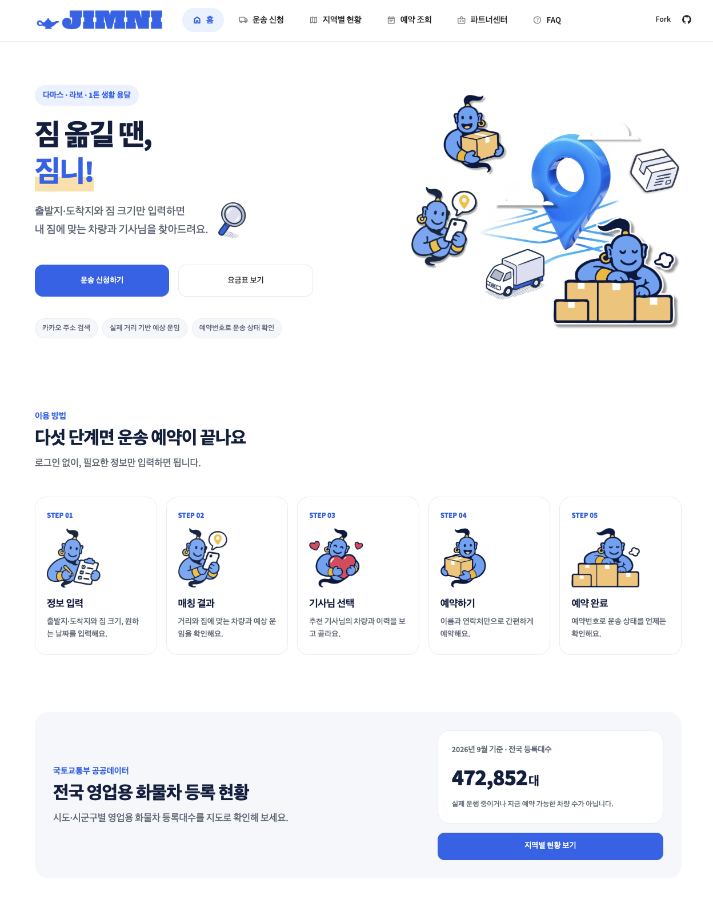
</p>

</details>

<details>
<summary><b>2. 운송 신청</b> · 정보 입력</summary>
<br>

- 카카오 주소 검색으로 출발지·도착지 선택, 지도에서 위치 확인
- 층수·엘리베이터, 짐 크기별(S·M·L·XL) 개수, 희망 일시, 추가 인력 입력

<p align="center">
  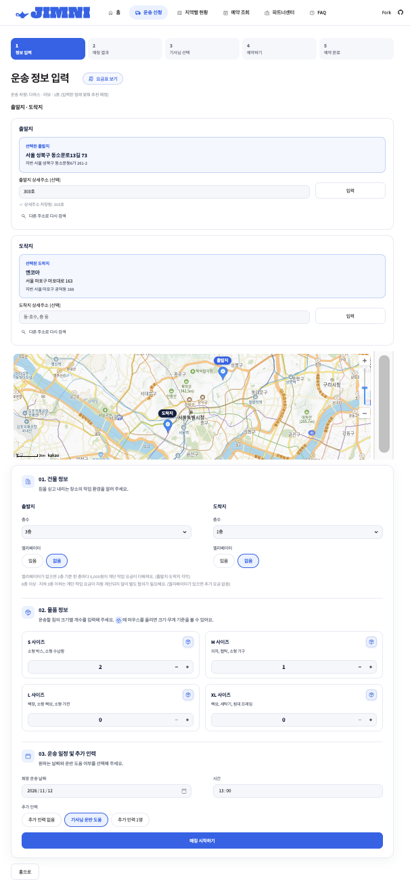
</p>

</details>

<details>
<summary><b>3. 매칭 결과</b> · 차량 · 운임 · 기사님 추천</summary>
<br>

- 짐에 맞는 가장 작은 차량, 실제 주행거리, 예상 소요시간, 항목별 예상 운임
- 조건에 맞는 기사님 5명을 가까운 순 · 별점 높은 순으로 비교 후 예약

<p align="center">
  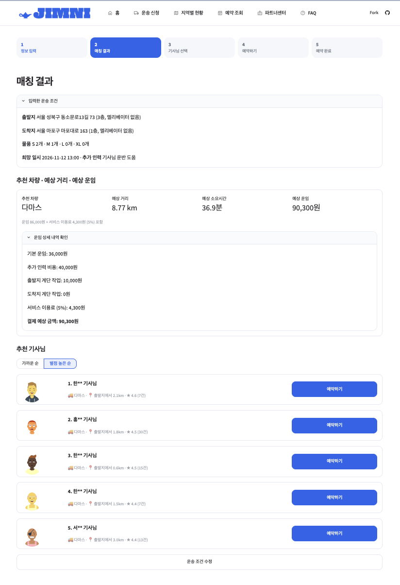
</p>

</details>

<details>
<summary><b>4. 예약하기</b> · 운임 동의 · 예약 확정</summary>
<br>

- 최종 운임과 작업 조건을 확인하고 동의하면 예약 확정
- 확정 즉시 기사님 매칭 알림과 예약번호 발급

<p align="center">
  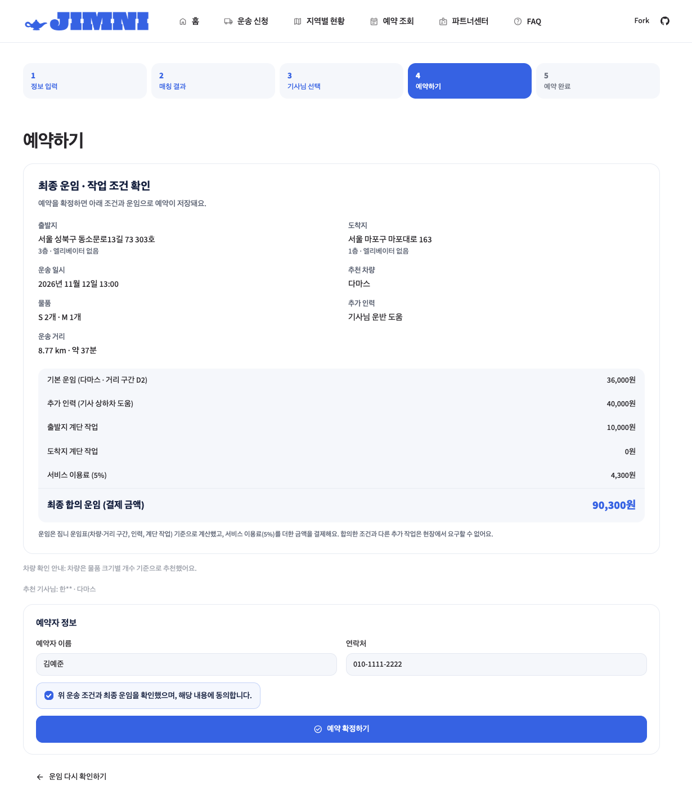
  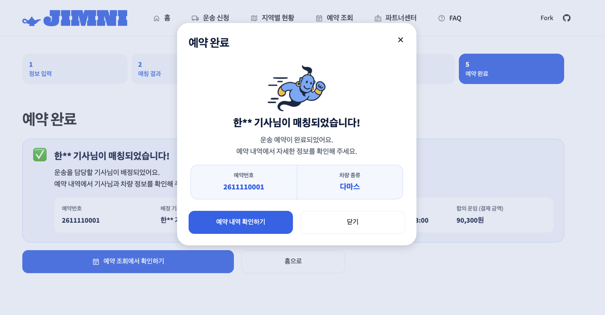
</p>

</details>

<details>
<summary><b>5. 예약 조회</b> · 운송 상태 · 별점 평가</summary>
<br>

- 예약번호와 연락처로 예약 정보와 운송 단계(예약 완료 → 기사 출발 → 운송 중 → 운송 완료) 확인
- 운송 완료 시 팝업에서 0.5점 단위 별점 평가, 기사님 평균 별점에 바로 반영

<p align="center">
  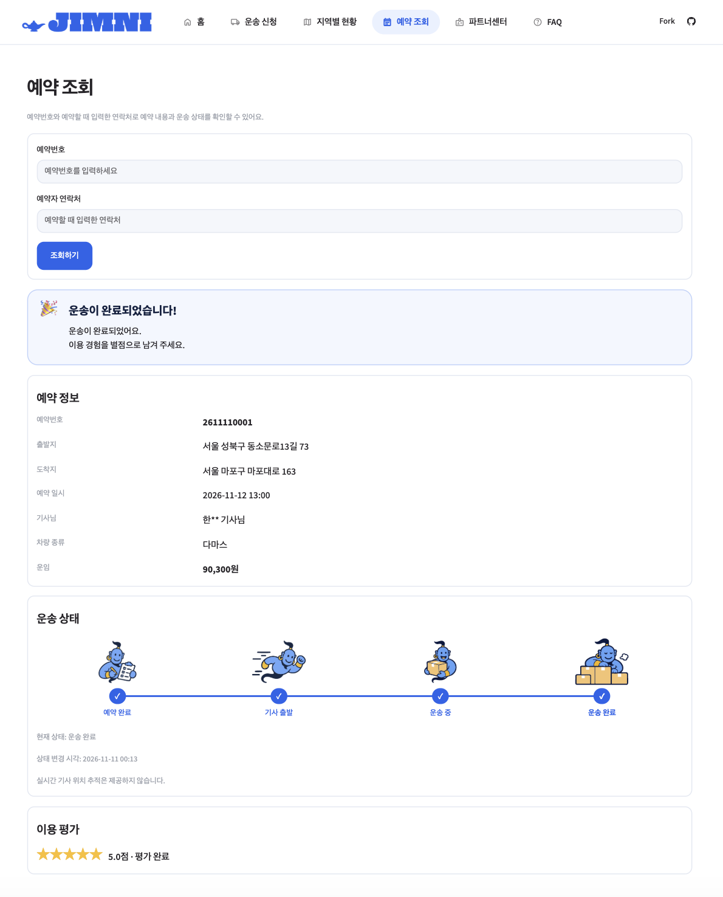
  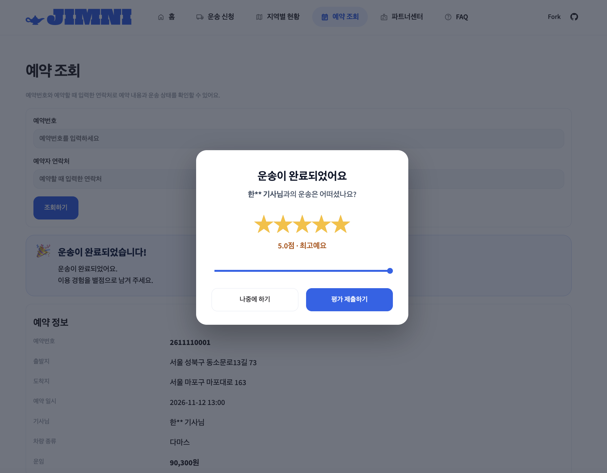
</p>

</details>

<details>
<summary><b>6. 지역별 현황</b> · 배차 가능 기사 · 화물차 등록</summary>
<br>

- 배차 가능 기사: 시연용 기사 10,000명의 지역·차종 분포와 기준 지역 주변 기사 목록
- 화물차 등록: 국토교통부 공공데이터 기반 시도별 버블 지도와 시군구별 등록대수

<p align="center">
  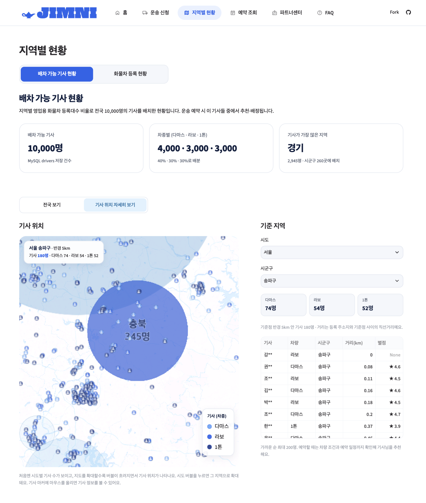
  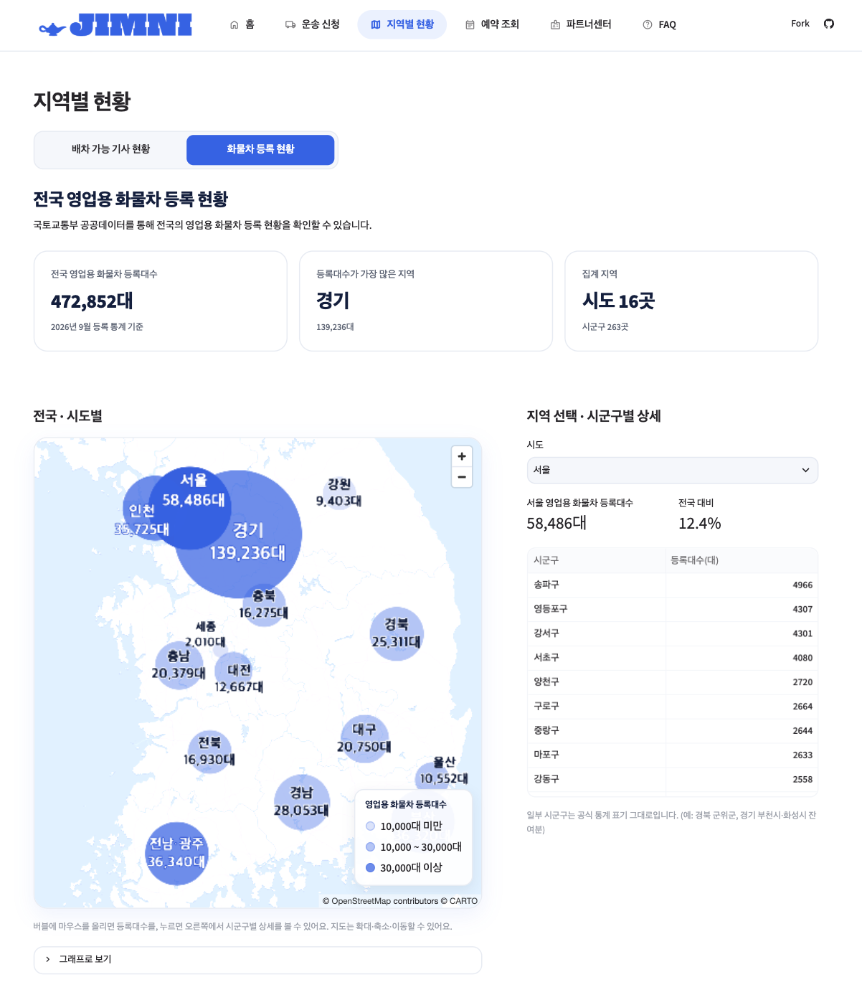
</p>

</details>

<details>
<summary><b>7. 파트너센터</b> · 기사님 전용</summary>
<br>

- 양면 플랫폼 확장을 위한 기사님 로그인 화면 (시연용, 실제 인증 없음)
- 가까운 운송 요청 · 일정 · 정산 관리 공간으로 확장 예정

<p align="center">
  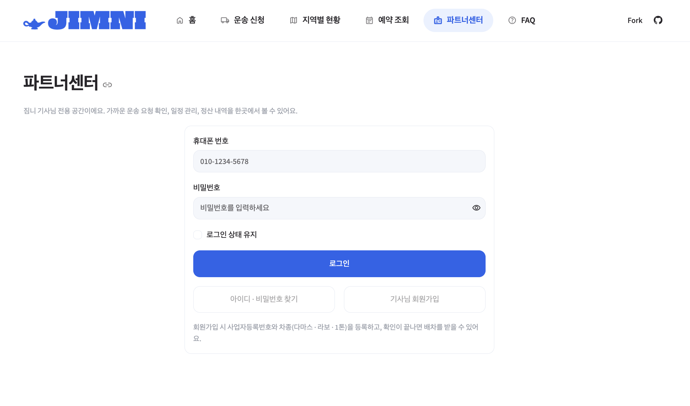
</p>

</details>

<details>
<summary><b>8. FAQ</b> · 자주 묻는 질문</summary>
<br>

- FAQ 29건을 카테고리별로 보고 키워드로 검색
- 요금표 보기 버튼으로 운임 기준표 페이지 이동

<p align="center">
  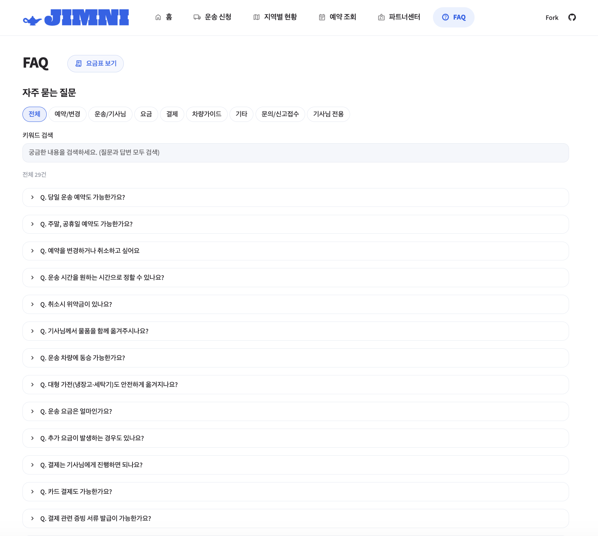
</p>

</details>

---

## Fare Guide

짐 크기·수량, 이동 거리, 층수, 인력 조건으로 예상 운임을 계산하고, 기사 수수료는 업계 평균 약 23%에서 **18%로 낮췄습니다.**

[운임 기준표 자세히 보기](docs/fare_table.md)

---

## Key Features

| 기능 | 설명 |
|:---|:---|
| 운송 신청 | 카카오 API 기반 주소 검색과 위치 확인, 물품·운송 조건 입력 |
| 운임 계산 및 차량 추천 | 도로 이동 거리, 물품 크기, 층수, 추가 인력을 반영한 예상 운임 계산 |
| 기사 추천 및 매칭 | 운송 조건과 지역을 고려한 시연용 기사 추천 및 예약 확정 시 자동 배정 |
| 사전 운임 동의 | 최종 운임과 작업 조건 확인, 조건 변경 시 운임 재계산 및 재동의 |
| 예약 조회 및 평가 | 예약번호와 연락처로 예약 조회, 상태 확인 및 운송 완료 후 별점 평가 |
| 웹 알림 | 기사 매칭 완료 알림 및 예약 상태별 안내 메시지 |
| FAQ | 팀에서 작성한 FAQ 29건에 대한 카테고리별 조회 및 키워드 검색 |
| 화물차 등록 현황 | 국토교통부 공공데이터 기반 버블 지도 및 시군구별 상세 조회 |

---

## Tech Stack


<p align="center">
  
  
  
  
  
  
</p>

## Data Collection & Processing

### Data Sources

| 데이터 | 제공 기관 | 활용 목적 |
|:---|:---|:---|
| [자동차등록현황보고](https://stat.molit.go.kr/portal/cate/statMetaView.do?hRsId=58) (OpenAPI, 2026년 9월) | 국토교통부 | 시도·시군구별 영업용 화물차 등록대수 수집 및 버블 지도 시각화 |
| 시군구별 영업용 화물차 등록현황 (2026년 9월) | 국토교통부 | 배차 가능 기사 10,000명을 시군구별 등록대수 비율에 따라 배분 |
| [전국 화물자동차 운송사업자 표준데이터](https://www.data.go.kr/data/15129433/standard.do) | 공공데이터포털 | 운송사업자 데이터 조사 및 지역명 표기 참고 |
| [센서스용 행정구역경계](https://www.data.go.kr/data/15125055/fileData.do) (시도, 2025-06-30 기준) | 국가데이터처 SGIS | 버블 지도의 시도별 대표 좌표 계산 |
| Kakao API (Local · Mobility) | Kakao | 주소·장소 좌표 검색, 기사 위치 데이터 수집, 주행거리·소요시간 계산 및 운임 산정 |

- 등록 통계와 운송사업자 표준데이터는 집계 기준이 다르므로 차량대수를 합산하지 않았으며, 운송사업자 표준데이터는 서비스 기능(기사 생성·매칭, 등록대수 집계)에 사용하지 않습니다.
- 배차 가능 기사 10,000명, 차종 비율(다마스 40% · 라보 30% · 1톤 30%), 별점은 등록대수 비율을 기준으로 팀이 생성한 데이터이며, 기사 위치는 실제 주소가 아닌 해당 시군구 안의 장소 좌표입니다.

### Data Collection

국토교통부 OpenAPI로 2026년 9월 데이터를 JSON으로 받아 Pandas로 정제한 뒤 MySQL에 저장했습니다.

1. 전체 자동차 등록 통계에서 **화물 > 영업용** 등록대수만 추출
2. 시도 소계 행은 저장하지 않고 검증에만 사용 (중복 집계 방지)
3. 시군구 합계와 공식 소계 대조, 누락값·중복 검증
4. `regions` · `data_sources` · `registration_stats`에 한 트랜잭션으로 저장 (시군구 263곳, 전국 472,852대)

새 기준월이 공표되면 같은 수집 스크립트로 중복 없이 갱신할 수 있습니다. 다만 매달 자동으로 실행되는 스케줄링은 아직 적용하지 않았습니다.

자세한 수집 과정은 [데이터 파이프라인 문서](docs/registration_pipeline.md)에서 확인할 수 있습니다.

---

## Database Design & ERD

짐니는 MySQL 기반의 관계형 데이터베이스를 사용하며, 총 **7개 테이블과 9개 외래 키(FK) 관계**로 구성되어 있습니다.

<p align="center">
  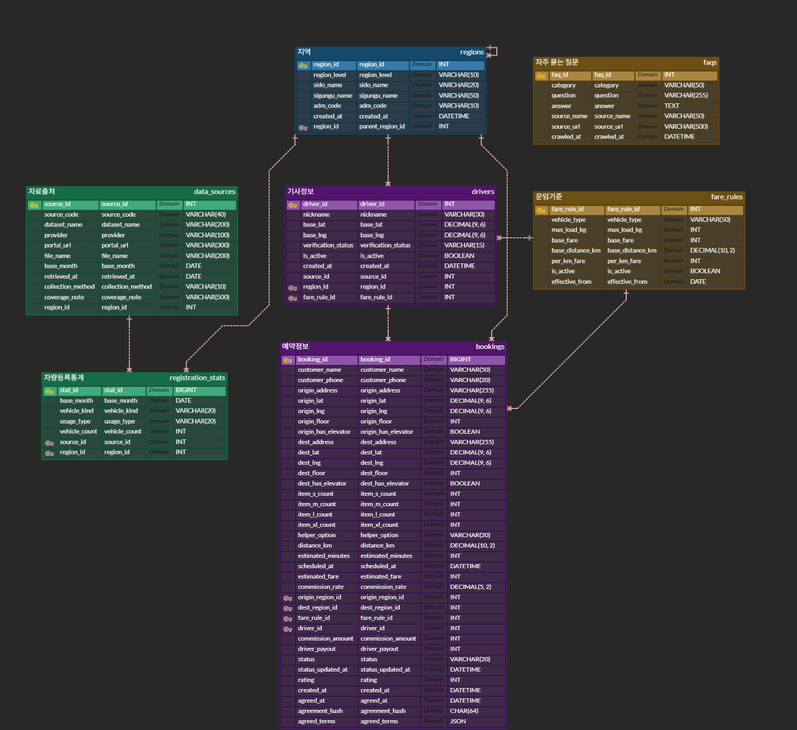
</p>

<p align="center">
  <a href="docs/erd_original.png">초기설계 ERD</a> ·
  <a href="sql/schema.sql">테이블 생성 SQL</a>
</p>

---

## Project Structure

<details>
<summary><b>폴더 구조 자세히 보기</b></summary>

```text
SKN38-1st-1Team/
├── app.py                 # Streamlit 진입점
├── pages/                 # 웹페이지
│   ├── 0_Home.py
│   ├── 1_Delivery_Request.py
│   ├── 2_Driver_Matching.py
│   ├── 3_Booking_Lookup.py
│   ├── 4_Truck_Map.py
│   ├── 5_FAQ.py
│   ├── 6_Booking.py
│   ├── 7_Fare_Table.py
│   └── 8_Driver_Login.py
├── services/              # 비즈니스 로직
│   ├── __init__.py
│   ├── db.py
│   ├── transport_request.py
│   ├── fare.py
│   ├── fare_table.py
│   ├── fare_rules_db.py
│   ├── settlement.py
│   ├── matching.py
│   ├── booking.py
│   ├── agreement.py
│   ├── assignment.py
│   ├── notifications.py
│   ├── booking_lookup.py
│   ├── kakao_local.py
│   ├── truck_stats.py
│   ├── truck_map.py
│   ├── driver_map.py
│   ├── driver_sim.py
│   ├── faq.py
│   └── ui.py
├── scripts/               # 데이터 수집 및 DB 적재
├── data/                  # 원본·전처리 데이터 및 FAQ
├── sql/                   # DB 스키마 및 쿼리
├── docs/                  # ERD 및 프로젝트 문서
├── assets/                # 로고·캐릭터·일러스트
├── .streamlit/            # Streamlit 설정
├── requirements.txt
├── .env.example
├── .gitignore
└── README.md
```

</details>

---


## Deployment

짐니는 **Streamlit Community Cloud**에 배포했으며, 데이터베이스는 **TiDB Cloud**를 사용합니다.

- **앱 배포:** Streamlit Community Cloud
- **클라우드 DB:** TiDB Cloud (MySQL 호환)
- **보안:** Streamlit Secrets로 환경변수 관리 및 SSL/TLS 암호화 연결

로컬 MySQL 데이터를 TiDB Cloud로 이전하고, `DB_SSL` 설정을 통해 클라우드 DB에 안전하게 연결했습니다.


<h2>👥 Meet the Team</h2>

<p align="center">
  <b>SK Networks Family AI Camp 38기 · 1팀</b>
</p>

<table align="center">
  <tr>
    <td align="center" width="170">
      
    </td>
    <td align="center" width="170">
      
    </td>
    <td align="center" width="170">
      
    </td>
    <td align="center" width="170">
      
    </td>
  </tr>

  <tr>
    <td align="center"><b>이지우</b></td>
    <td align="center"><b>김예준</b></td>
    <td align="center"><b>정흥기</b></td>
    <td align="center"><b>최웅</b></td>
  </tr>

  <tr>
    <td align="center">
      <sub>PM &amp;<br>Full-Stack Developer</sub>
    </td>
    <td align="center">
      <sub>Full-Stack<br>Developer</sub>
    </td>
    <td align="center">
      <sub>Data<br>Engineering</sub>
    </td>
    <td align="center">
      <sub>Planning &amp;<br>UI/UX Design</sub>
    </td>
  </tr>

  <tr>
    <td align="center">
      <sub>
        ERD 설계<br>
        데이터 파이프라인 구현<br>
        카카오모빌리티 API 연동<br>
        운임 계산·기사 매칭 구현<br>
        예약 로직 구현
      </sub>
    </td>
    <td align="center">
      <sub>
        프로젝트 총괄<br>
        카카오 주소 검색 API 연동<br>
        공공데이터 파이프라인 구축<br>
        지도 시각화·예약 조회·평가 구현
      </sub>
    </td>
    <td align="center">
      <sub>
        공공데이터 수집<br>
        데이터 전처리·검증<br>
        ERD 설계
      </sub>
    </td>
    <td align="center">
      <sub>
        서비스 아이디어·기획 주도<br>
        사용자 흐름·디자인 기획<br>
        ERD 설계<br>
        발표 준비
      </sub>
    </td>
  </tr>
</table>
